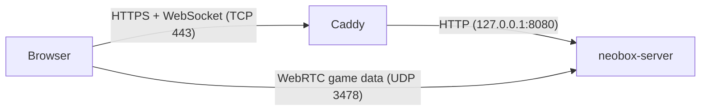

# Deploying neobox

This guide puts neobox online at `https://neobox.aggressivecombo.com` on a
small Linux server. No prior server experience is assumed: every command is
given. Expect about an hour the first time.

## What runs where (and why)



* **One program, `neobox-server`**, does everything: it serves the web page,
  runs the game rooms, relays player inputs, and hosts the admin page. It is
  written in Rust, uses very little memory (a few MB per room) and keeps
  accounts, levels, the map library and recorded menu clips in one SQLite
  file (no database server to run).
* **Caddy** sits in front of it and handles HTTPS. It obtains and renews the
  certificate from Let's Encrypt automatically.
* **Game traffic** uses a WebRTC data channel over UDP when possible
  (lowest latency: a lost packet never holds up the next one) and falls back
  to the WebSocket automatically when UDP is blocked (some office or school
  networks). Nothing to configure in the browser.
* **Jukebox:** players' browsers load YouTube's embedded player directly; the
  server only makes outbound HTTPS requests to `www.youtube.com/oembed` to
  read video titles. If outbound HTTPS is blocked, suggestions show the
  video id instead of the title.

Why these choices: a single binary is the simplest thing to run and update;
Caddy is the simplest way to get HTTPS right; UDP is what fast-paced games
need, but WebSocket fallback keeps the game reachable everywhere.

## Requirements

| Item | Minimum | Notes |
| --- | --- | --- |
| VPS | 1 vCPU, 1 GB RAM, 10 GB disk | 2 vCPU / 2 GB is comfortable for hundreds of players. Any provider works (Hetzner, OVH, DigitalOcean, Vultr…). Pick a region close to your players. |
| OS | Debian 12 or Ubuntu 24.04 (64-bit) | Commands below assume one of these. |
| Public IPv4 | 1 | Included with every VPS. |
| Domain | `neobox.aggressivecombo.com` | You need access to the DNS settings of `aggressivecombo.com`. |
| Open ports | TCP 22, TCP 80, TCP 443, UDP 3478 | 22 = SSH (your access), 80/443 = web, 3478 = game data. |
| Bandwidth | ~5 KB/s per player | 1 TB/month (typical included traffic) is plenty. |

## 1. Create the server

1. Create a VPS with Debian 12 or Ubuntu 24.04 at your provider. Add your SSH
   key when asked (or note the root password).
2. Note its **public IPv4 address**, below written `203.0.113.10`.
3. If the provider has a cloud firewall, allow inbound TCP 22, 80, 443 and
   UDP 3478.

## 2. Point the domain at it

In the DNS settings of `aggressivecombo.com`, add a record:

| Type | Name | Value | TTL |
| --- | --- | --- | --- |
| A | `neobox` | `203.0.113.10` | Auto / 300 |

If the DNS is on Cloudflare, set the record to **DNS only** (grey cloud).
Wait a few minutes, then check from your PC: `nslookup neobox.aggressivecombo.com`
must print the server's IP.

## 3. Prepare the server

Connect: `ssh root@203.0.113.10`, then run:

```sh
apt update && apt upgrade -y
apt install -y curl git unzip build-essential ufw sqlite3 debian-keyring debian-archive-keyring apt-transport-https

# firewall
ufw allow 22/tcp && ufw allow 80/tcp && ufw allow 443/tcp && ufw allow 3478/udp
ufw --force enable

# a user without privileges for the game server
useradd --system --home /opt/neobox --shell /usr/sbin/nologin neobox
mkdir -p /opt/neobox

# Caddy (HTTPS)
curl -1sLf 'https://dl.cloudsmith.io/public/caddy/stable/gpg.key' | gpg --dearmor -o /usr/share/keyrings/caddy-stable-archive-keyring.gpg
curl -1sLf 'https://dl.cloudsmith.io/public/caddy/stable/debian.deb.txt' > /etc/apt/sources.list.d/caddy-stable.list
apt update && apt install -y caddy

# build tools: Rust and Bun
curl --proto '=https' --tlsv1.2 -sSf https://sh.rustup.rs | sh -s -- -y
curl -fsSL https://bun.sh/install | bash
source ~/.cargo/env && export PATH="$HOME/.bun/bin:$PATH"
```

## 4. Build neobox

Get the source onto the server. Once the repository is published on GitHub:

```sh
git clone https://github.com/AggressiveCombo/neobox.git ~/neobox
cd ~/neobox && git checkout rewrite
```

(Before it is published, copy it from your PC instead:
`scp -r C:\Users\aggressivecombo\neobox-rewrite root@203.0.113.10:~/neobox`.)

Then build (5–15 minutes the first time):

```sh
cd ~/neobox
bash deploy/build.sh
```

This produces `dist-server/` with the server binary, the web client and the
built-in maps.

## 5. Install

```sh
cd ~/neobox
cp -r dist-server/* /opt/neobox/
chown -R neobox:neobox /opt/neobox

cp deploy/neobox.env.example /etc/neobox.env
chmod 600 /etc/neobox.env
nano /etc/neobox.env      # set NEOBOX_ADMIN_PASSWORD (long and random); Ctrl+O, Enter, Ctrl+X

cp deploy/neobox.service /etc/systemd/system/neobox.service
systemctl daemon-reload
systemctl enable --now neobox

cp deploy/Caddyfile /etc/caddy/Caddyfile
systemctl reload caddy
```

## 6. Check

* `systemctl status neobox` shows `active (running)`; the log line
  `WebRTC transport listening (UDP)` confirms UDP is enabled.
* Open `https://neobox.aggressivecombo.com`: the menu appears.
* Open `https://neobox.aggressivecombo.com/admin` and log in with the
  admin password. Join a game from another tab: the room and player appear
  live; the player's ping column shows `udp` when WebRTC works, `ws` when it
  fell back to the WebSocket.

If players always show `ws`: check that UDP 3478 is open (both `ufw` and
the provider's firewall), and set `NEOBOX_RTC_PUBLIC=203.0.113.10:3478` in
`/etc/neobox.env`, then `systemctl restart neobox`.

## Updating

```sh
cd ~/neobox && git pull && bash deploy/build.sh
cp -r dist-server/* /opt/neobox/ && chown -R neobox:neobox /opt/neobox
systemctl restart neobox
```

Restarting ends running matches; players reconnect from the menu. Accounts,
friends and the map library are kept (they live in `/var/lib/neobox`, which
updates never touch).

## Backups

Everything players create is in one SQLite database,
`/var/lib/neobox/neobox.db`. The server keeps it in WAL mode, so copying the
file while the server runs can give a broken copy; use SQLite's online backup
instead. A daily backup that keeps the last 14 days:

```sh
mkdir -p /var/backups/neobox
cat > /etc/cron.daily/neobox-backup <<'EOF'
#!/bin/sh
sqlite3 /var/lib/neobox/neobox.db ".backup '/var/backups/neobox/neobox-$(date +%F).db'"
find /var/backups/neobox -name 'neobox-*.db' -mtime +14 -delete
EOF
chmod 755 /etc/cron.daily/neobox-backup
```

Copy `/var/backups/neobox` off the server now and then (a VPS can be lost).
To restore: `systemctl stop neobox`, copy a backup to
`/var/lib/neobox/neobox.db`, delete `neobox.db-wal` and `neobox.db-shm` next to
it, `chown neobox:neobox /var/lib/neobox/neobox.db`, `systemctl start neobox`.

## Everyday operations

| Task | Command / place |
| --- | --- |
| Live rooms, players, tick rate, latency, bandwidth, logs, kick/ban, close rooms | `https://neobox.aggressivecombo.com/admin` |
| Approve or reject maps uploaded to the public library; find and delete any map | `https://neobox.aggressivecombo.com/admin`, "Map approvals" and "Map library" |
| Server log | `journalctl -u neobox -f` |
| Restart | `systemctl restart neobox` |
| Add built-in maps | put map files in `/opt/neobox/maps/` (`.txt` with a Hitbox map code, or `.json` compact map JSON), then restart |
| Change limits | edit `/etc/neobox.env` (see comments there), then restart |

## Configuration reference

All settings are environment variables (in `/etc/neobox.env`).

| Variable | Default | Meaning |
| --- | --- | --- |
| `NEOBOX_ADMIN_PASSWORD` | (empty: admin page disabled) | Admin page password. |
| `NEOBOX_BIND` | `127.0.0.1:8080` | HTTP address (Caddy forwards to it). |
| `NEOBOX_STATIC` | `client` | Web client directory. |
| `NEOBOX_MAPS` | `maps` | Built-in maps directory. |
| `NEOBOX_DATA` | `data/neobox.db` (the service sets `/var/lib/neobox/neobox.db`) | SQLite database: accounts, friends, map library. Created on first start. |
| `NEOBOX_RTC_BIND` | `0.0.0.0:3478` | UDP address for WebRTC game data; `off` disables WebRTC. |
| `NEOBOX_RTC_PUBLIC` | auto-detected | Public `IP:port` browsers use to reach the UDP port. |
| `NEOBOX_MAX_ROOMS` | `200` | Room limit. |
| `NEOBOX_MAX_PLAYERS` | `32` | Players per room limit (rooms choose 1..this). |
| `NEOBOX_MAX_CONNS_PER_IP` | `8` | Simultaneous connections per IP address. |
| `NEOBOX_TRUST_PROXY` | `true` | Use the client IP forwarded by Caddy. Set `false` if the server is exposed directly. |
| `RUST_LOG` | `info` | Log detail (`debug` for more). |

## Running locally (development)

On your PC (Windows, macOS or Linux) with Rust and Bun installed:

```sh
bash deploy/build.sh
cd dist-server
NEOBOX_ADMIN_PASSWORD=dev ./neobox-server      # Windows PowerShell: $env:NEOBOX_ADMIN_PASSWORD="dev"; .\neobox-server.exe
```

Open `http://127.0.0.1:8080` (game) and `http://127.0.0.1:8080/admin`.
