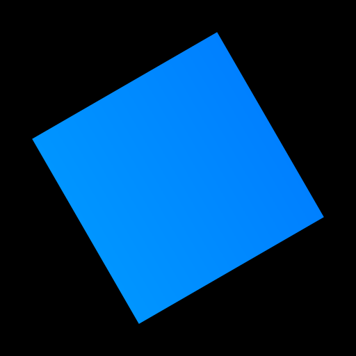

<h1>
   neobox
</h1>

A free and open-source spiritual successor to
[Hitbox.io](https://hitbox.io), the physics platform-fighter by **Chaz**
(also the creator of Bonk.io). neobox recreates Hitbox.io's gameplay
number-for-number, loads Hitbox.io maps, and is built to be fast,
scalable (rooms of up to 32 players) and maintainable, with first-class
mobile support.

neobox is a fan project. It is not affiliated with or endorsed by Chaz or
Hitbox.io, and it contains no Hitbox.io code, art, sounds or fonts.

## Why?

Hitbox.io has many issues.  
These include bugs, memory leaks, and exploits (see [Hitbox.io Wiki - Glitches](https://hitbox.fandom.com/wiki/Glitches) for an example).  
This results in an unpleasant experience, especially for competitive players in longer sessions.

I believe in open source, and a project such as this is an immensely useful learning exercise.  
It's also a way to fix a game I enjoy.

## Goals / Motivation

For there to be a useful alternative, it needs to be better than the original.  
This is why I have set up some goals that I believe will make the project an improvement over the original.

### Highly Performant

- Even small maps on hitbox.io (with a low number of physics objects) can get very laggy on older systems with more than a couple of players.  
  Improving performance would make playing more accessible to more players.

### Scalable

- Hitbox.io only allows up to 10 players per lobby. This is fine for simpler maps, but for FFA maps, this is inadequate.

### Maintainable

- Chaz, the developer of hitbox.io, has not updated their game in more than a year. The fact that their game is closed-source means that no one else can contribute to the game.  
  This means that a serious bug or vulnerability won't get fixed nearly as fast as one found on an open-source project will.

## Highlights

* **Same feel as the original.** The physics engine is a bit-exact Rust
  port of the Box2D build Hitbox.io runs on, and the game rules are
  verified tick-by-tick against trajectories recorded from the original
  game (`tests/reference`). Differences are deliberate and listed in
  [DEVIATIONS.md](DEVIATIONS.md).
* **Hitbox.io maps work.** Paste a map code or load a map file in the lobby,
  pick one from the map library, or make your own in the map editor.
* **Low latency netcode.** Deterministic 30 Hz simulation with client-side
  prediction and rollback; the server stamps inputs, so there is no host
  advantage and no desync from frame-rate differences. Game data travels
  over WebRTC (UDP-like) with automatic WebSocket fallback.
* **Playing together.** Quick play as on hitbox.io: "Sweaty Bois" (four
  players, last one standing, two round wins per map) and "Team Madness"
  (eight players in teams sharing 50 lives) with their map rotations, plus
  the week's best-rated library maps. Also invite links, password rooms, and
  reconnecting to your own slot after a dropped connection or a page reload.
  The room list shows each room's distance and its host's flag, nearest
  first with friends' rooms on top. Optional regional game servers: new
  rooms open on the server nearest to you. Hosts manage teams, lock teams,
  kick, ban and unban, hand over the host role, count down and start
  matches, and end them from the room screen or with chat commands (`/help`).
* **Levels.** Experience for every finished game (more for better places),
  a post-game screen with your level bar and a vote on the map, and levels
  shown next to names. Awards are computed by the server.
* **Room life.** A YouTube jukebox (paste a link in chat, the host plays it),
  appearance colours, typing indicators, emoji shortcodes such as `:fire:`,
  a profanity filter and friend requests from the lobby.
* **Accounts (optional).** Sign in to keep your level and settings on every
  device, add friends, see who is online and join their room, and publish maps.
* **Map library.** Upload maps (public, unlisted or private) with a
  description, browse hot, top, newest and staff-picked maps, search, vote
  and star them. Public maps appear once an admin approves them. The main
  menu lists the week's top map makers.
* **Replays, training and practice.** `/record` sends the last 15 seconds
  of a match to the main menu, which plays recorded clips in its background;
  save any finished match as a replay and watch it with pause, speed and
  seeking; learn the controls in the training hall; practise alone on any
  map without a server.
* **Your settings.** Key rebinding, volume, menu music, render scale and
  anti-aliasing, colour-blind palettes, touch control size and a left-handed
  layout.
* **Runs everywhere.** WebGPU renderer with a WebGL2 fallback, dynamic
  resolution, any refresh rate; keyboard, gamepad and full touch controls;
  iOS Safari included.
* **Admin interface.** Live rooms, players, tick rate, latency, bandwidth,
  match state and logs, kick/ban/close controls, the map approval queue,
  staff picks and recorded clips (`/admin`).

## Layout

| Path | What |
| --- | --- |
| `crates/box2d` | Bit-exact port of Hitbox.io's Box2D build (Zlib licence, like Box2D). |
| `crates/sim` | Deterministic game simulation and the Hitbox map format. |
| `crates/net` | Wire protocol, server input timeline, client prediction/rollback. |
| `crates/wasm` | The browser game module (simulation + netcode + frame building). |
| `crates/server` | Game server: rooms, WebSocket/WebRTC transport, accounts/friends/library HTTP API, admin interface. |
| `crates/store` | SQLite storage for accounts, sessions, friends and the map library. |
| `crates/bots` | Headless bot players for load and soak tests (`cargo run --release -p neobox-bots -- ws://127.0.0.1:8080/ws 32 120`). |
| `client` | Web client (TypeScript, no framework): renderer, input, UI, audio. |
| `maps` | Built-in maps. |
| `tests`, `tools` | Reference recordings from the original game and the tools that make them. |
| `deploy` | Build script, systemd unit and Caddy configuration. |
| `docs` | Interface notes. |

## Building and running

Requirements: [Rust](https://rustup.rs) and [Bun](https://bun.sh).

```sh
bash deploy/build.sh                         # builds dist-server/
cd dist-server && NEOBOX_ADMIN_PASSWORD=dev ./neobox-server
```

Open <http://127.0.0.1:8080>. To put it online see [DEPLOY.md](DEPLOY.md).

Tests:

```sh
cargo test --release                         # includes the reference trajectories and server end-to-end tests
bash deploy/build.sh && (cd client && bun run e2e)   # browser end-to-end suite (headless Chromium)
```

## Credits

* **Chaz**, creator of Hitbox.io, whose game this project pays tribute to.
* Box2D by Erin Catto; Box2DFlash/box2dweb ports by their authors.
* Third-party music and data (menu music, emoji names, the profanity word
  list) are listed in [CREDITS.md](CREDITS.md).

## Licence

neobox is free software under the
[GNU Affero General Public License v3.0 or later](LICENSE). The physics
crate `crates/box2d` is under the Zlib licence (see its `LICENSE`).
